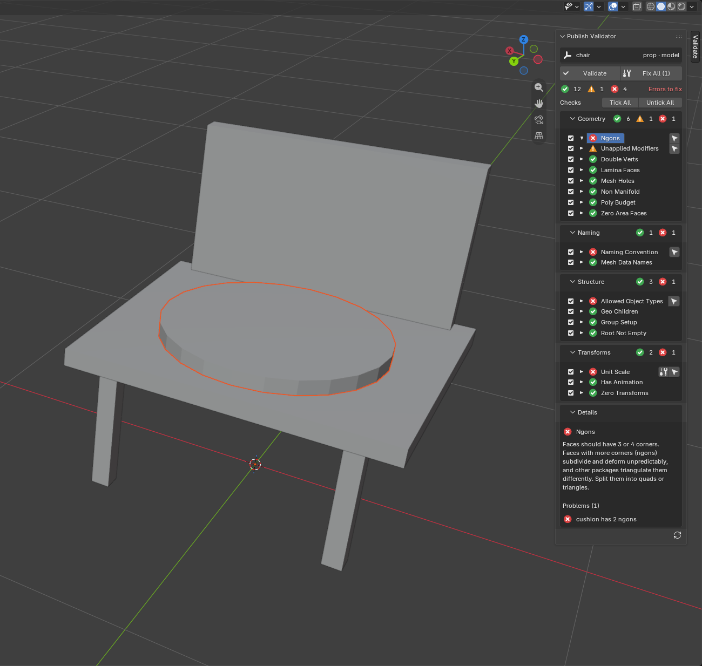
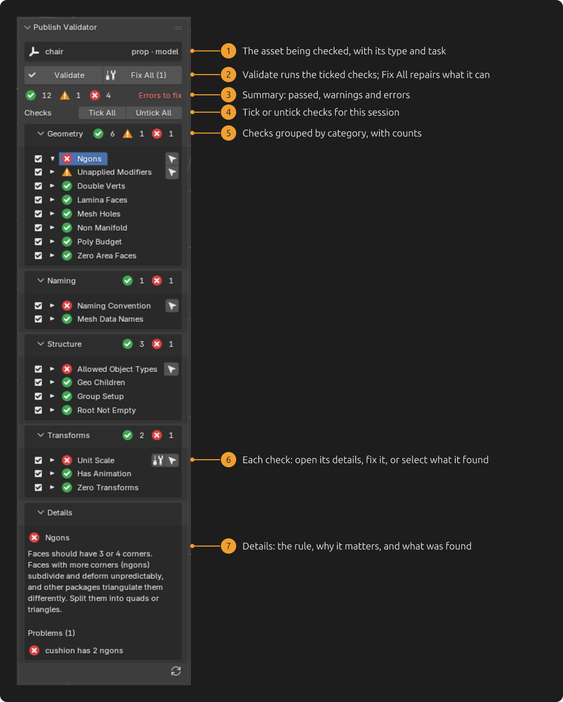
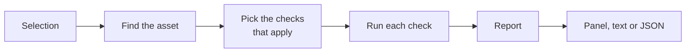

# Publish Validator

**Catch broken assets before they're published.** Publish Validator checks a 3D
asset against your studio's rules (structure, naming, transforms, geometry),
shows what's wrong in a native Blender panel, and fixes what it safely can. The
same checks run headless as a publish gate.

[](https://github.com/jmleventhorpe/publish-validator/releases)
[](https://www.blender.org)
[](https://www.python.org)
[](LICENSE)



- **16 built-in checks** for models, from group layout and naming to ngons and
  non-manifold edges. Geometry checks select the exact faces, edges or vertices.
- **Adding a check means writing one small Python class.** Drop the file in a
  folder and it appears in the panel.
- **Studios tune it without code:** switch checks off, change severities and
  adjust settings in layered TOML config.
- **Runs with or without a UI:** the Blender panel for artists, and a command
  line with exit codes and JSON for publish hooks and the farm.

## Contents

- [Quick start](#quick-start)
- [The panel](#the-panel)
- [Built-in checks](#built-in-checks)
- [Writing a check](#writing-a-check)
- [Studio configuration](#studio-configuration)
- [Headless runs and publish hooks](#headless-runs-and-publish-hooks)
- [How it works](#how-it-works)
- [Roadmap](#roadmap)
- [Development](#development)

## Quick start

1. **Install** `publish_validator-0.1.0.zip` from the
   [latest release](https://github.com/jmleventhorpe/publish-validator/releases):
   in Blender, go to Edit > Preferences > Get Extensions > Install from Disk.
2. **Mark your asset's root** (usually an Empty with the asset parented under
   it) with custom properties:

   | Property | Example | Notes |
   |---|---|---|
   | `pv_task` | `model` | Required: this is what marks the root |
   | `pv_asset_type` | `prop` | Used to pick checks for this kind of asset |
   | `pv_asset_name` | `chair` | Optional; defaults to the object's name |

3. **Validate:** select anything in the asset, open the 3D viewport's sidebar
   (<kbd>N</kbd>), choose the **Validate** tab and press **Validate**.

To try it without setting anything up, clone the repo and run the demo. It
builds a chair with a few deliberate problems and opens the panel:

```bash
blender --python scripts/blender_demo.py
```

## The panel



- **Ticking:** untick a check to skip it while you work. A headless publish
  still runs every check.
- **Fix:** fixing re-runs the check, so the panel always shows what's really
  left.
- **Out of date:** if the asset changes after validating, the panel says the
  results are out of date.

## Built-in checks

All of these run for the **model** task. None fix anything automatically,
except Unit Scale.

| Check | Category | Looks for |
|---|---|---|
| Root Not Empty | Structure | An asset root with nothing under it |
| Group Setup | Structure | The standard layout: root > `geo` (> `render`, `proxy`) and `simproxy` |
| Allowed Object Types | Structure | Cameras, lights and other non-mesh, non-empty objects |
| Geo Children | Structure | Meshes parented under other meshes |
| Naming Convention | Naming | `seat`, `L_frontLeg`, `legs`, and `seat_proxy` under proxy; no `.001` endings |
| Mesh Data Names | Naming | Mesh data named differently from its object |
| Unit Scale | Transforms | Mesh objects with a scale other than 1 (can fix) |
| Zero Transforms | Transforms | Objects whose origin isn't at the world centre, or that are rotated |
| Has Animation | Transforms | Keyframes, drivers or NLA tracks |
| Unapplied Modifiers | Geometry | Modifiers other than Subdivision (warning) |
| Ngons | Geometry | Faces with more than 4 corners |
| Zero Area Faces | Geometry | Faces squashed flat to nothing |
| Lamina Faces | Geometry | Faces that share all their corners with another face |
| Double Verts | Geometry | Vertices sitting on top of each other |
| Non Manifold | Geometry | Edges shared by more than two faces |
| Mesh Holes | Geometry | Open borders, i.e. edges with a face on one side only (warning) |

Root Not Empty and Group Setup work in any application; the rest are
Blender-only for now.

## Writing a check

A check is a class in a `.py` file. Put the file in a folder listed in
`PUBLISH_VALIDATOR_PATH` (or in config) and it shows up in the panel:

```python
from publish_validator import Check


class HasGeoGroup(Check):
    """The asset needs a 'geo' group.

    Everything downstream looks for geometry under 'geo'. Create an empty
    called 'geo' under the asset root and parent the meshes to it.
    """

    category = "Structure"

    def validate(self, ctx):
        names = [ctx.host.node_name(node) for node in ctx.host.children(ctx.root)]
        if "geo" not in names:
            yield self.issue("There is no 'geo' group", ctx.root)
```

The docstring becomes the check's description in the panel. Checks can also
declare where they apply (`hosts`, `tasks`, `asset_types`), expose `settings`
that studios can tune, and add a `fix()`. The full guide is
[docs/writing-checks.md](docs/writing-checks.md), and
[examples/studio_checks](examples/studio_checks) shows a studio's own check
folder.

## Studio configuration

Behaviour is changed in TOML, not code. Files listed in
`PUBLISH_VALIDATOR_CONFIG` are layered in order, so a project file only needs
what differs from the studio's:

```toml
check_paths = ["checks"]                 # your own check folders

[checks.UnappliedModifiers]
settings = { allowed = ["SUBSURF", "BEVEL"] }

[checks.MeshHoles]
enabled = false                          # e.g. for a project full of leaf cards
```

Typos and wrong value types in config are reported when the checks load, not
silently ignored. If your pipeline stores asset information somewhere other
than custom properties, point `resolver` at your own class; see
[docs/architecture.md](docs/architecture.md#extending-it).

## Headless runs and publish hooks

```bash
blender -b scene.blend --python-exit-code 1 \
  --python-expr "import sys; from publish_validator.cli import main; sys.exit(main())" \
  -- --all
```

The exit code is 0 if nothing blocks the publish, 1 if something does, and 2
for usage errors. Add `--json` for a machine-readable report, `--fix` to apply
fixes, or `--root NAME` to check one asset. From Python:

```python
from publish_validator import Validator
from publish_validator.hosts import current_host

report = Validator(current_host()).run()   # validates the selected asset
print(report.as_text())
```

## How it works



The core is plain Python with no Blender, Maya or Houdini imports. Each
application plugs in through a small host adapter, and each check runs in its
own safety net, so one broken check never stops the others.

- **[Architecture](docs/architecture.md):** how the pieces connect, file by file.
- **[Design notes](docs/design.md):** the decisions behind it, including why
  the Blender UI is a native panel rather than Qt.

## Roadmap

| Application | Status |
|---|---|
| Blender | Supported: host adapter, panel and 16 checks. Tested on Blender 5.2 |
| Maya | Host adapter written, not yet tested in Maya; no UI yet |
| Houdini | Host adapter written, not yet tested in Houdini; no UI yet |

Next up: lookdev and rigging checks, and a Maya UI built on the same core.

## Development

```bash
uv run --python 3.11 --group dev pytest   # core tests (also run with --python 3.13)
uv run --group dev ruff check
blender -b --factory-startup --python-exit-code 1 --python tests/blender/run.py
python scripts/build_blender_extension.py # builds dist/publish_validator-<version>.zip
```

See [CONTRIBUTING.md](CONTRIBUTING.md) for adding checks and the code style,
and [CHANGELOG.md](CHANGELOG.md) for what changed.

## License

[GPL-3.0-or-later](LICENSE). Blender add-ons must be GPL-compatible.

---

Made by [James Leventhorpe](https://github.com/jmleventhorpe).
