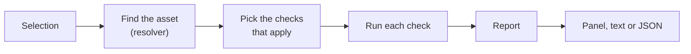
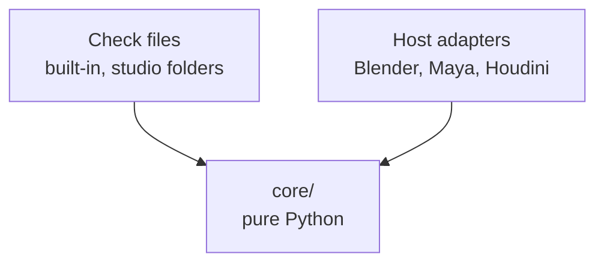

# Architecture

How the pieces of Publish Validator fit together. For the reasoning behind
them, see [design.md](design.md).

## What happens when you press Validate



1. **Find the asset.** The resolver walks up from whatever is selected to the
   asset's root, and reads its name, type and task.
2. **Pick the checks.** Only checks whose host, task and asset type match are
   used, minus any the studio has disabled in config.
3. **Run each check**, each in its own safety net. With Fix, a check repairs
   what it can and then runs again.
4. **Report.** Results are data, so the same report feeds the panel, the
   command line's text output and JSON.

When the `Validator` is first created, it reads the config files and loads
every check file once. Anything that fails to load is listed as a loading
problem, not raised.

## Who may talk to the application



The core never imports `bpy`, `maya` or `hou`. Checks build on it by
subclassing `Check`; applications plug in by subclassing `Host`. A check
limited to Blender may also use Blender's own API and the Blender host's
helpers, such as `meshes()`.

## Extending it

### Using your pipeline's asset data

By default the asset is found from `pv_*` custom properties on its root. If
your pipeline stores asset information somewhere else, write a resolver class
with `resolve(host, node=None)`, which returns a `Subject` or raises
`ResolveError` with a message for the artist, and `find_all(host)`. Then name
it in config:

```toml
resolver = "my_pipeline.validator:PipelineResolver"
```

Subclassing `PropertyResolver` is the easiest start. For example, set
`prefix = "studio_"` to read `studio_task` and so on.

### Supporting another application

Subclass `Host` and fill in `selection`, `select`, `find`, `parent`,
`children`, `get_property` and `find_by_property`. Then add the application to
`current_host()` in `hosts/__init__.py`.

## Which file does what

| File | Job |
|---|---|
| `core/check.py` | `Check`, the base class every check inherits from, and `Context`, what a check works with |
| `core/validator.py` | `Validator`: loads everything, runs checks, builds the report |
| `core/loader.py` | Finds and imports check files |
| `core/config.py` | Reads and merges the TOML config files |
| `core/subject.py` | Works out which asset is selected (`PropertyResolver`) |
| `core/host.py` | `Host`, the base class for each application |
| `core/results.py` | `Issue`, `CheckResult` and `Report`, with text and JSON output |
| `hosts/blender/` | The Blender host and sidebar panel |
| `checks/` | Built-in checks; `generic/` runs anywhere, `blender/` only in Blender |
| `cli.py` | Command line for headless runs and publish hooks |
| `testing.py` | `FakeNode` and `FakeHost`, for testing checks without an application |
