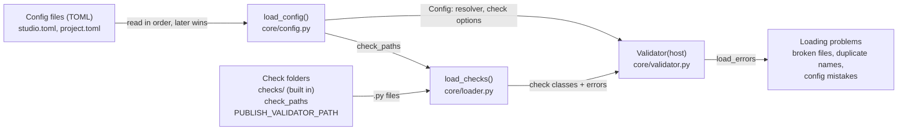
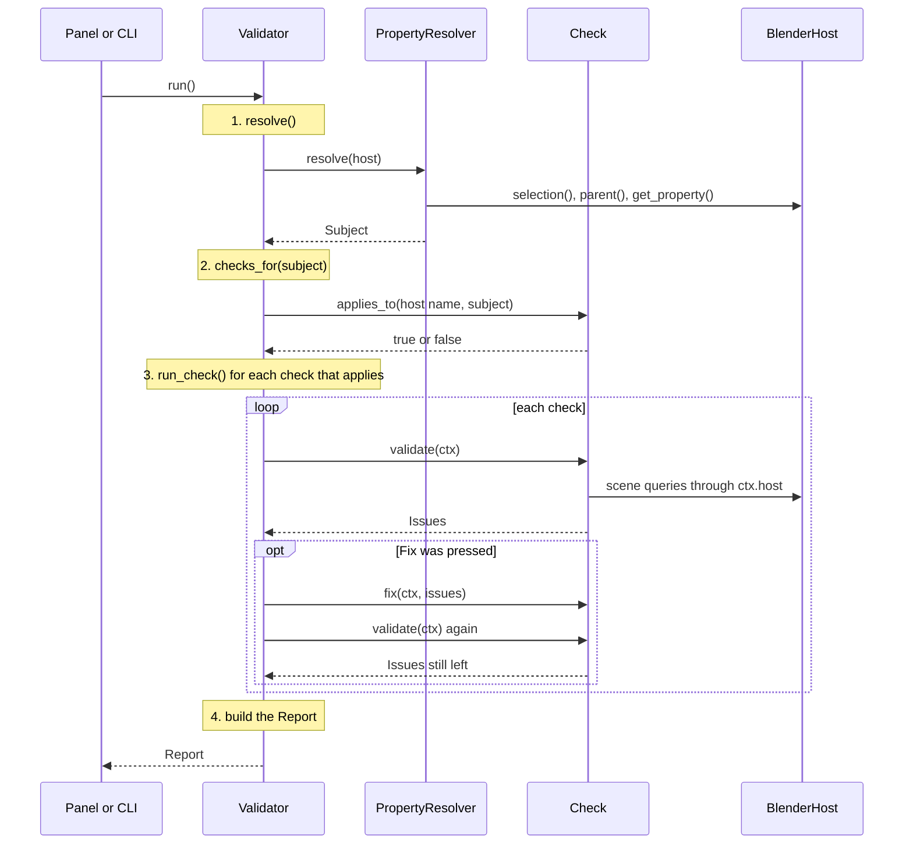
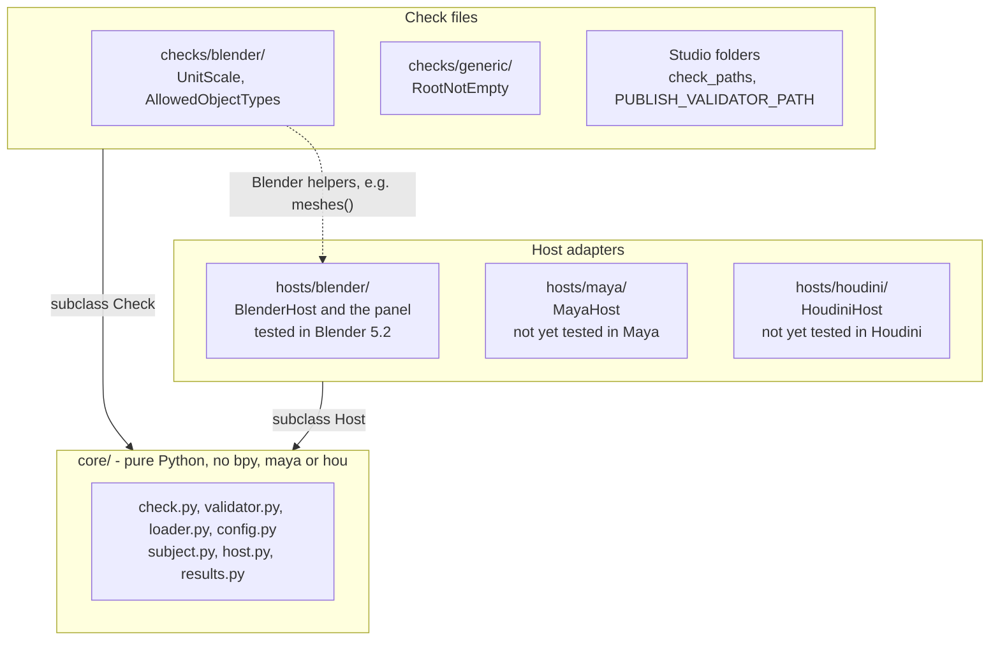

# Architecture

How the pieces of Publish Validator connect: what happens once when the
validator starts, what happens on every Validate click, and which code is
allowed to talk to Blender, Maya or Houdini.

## Starting up: config and checks

Creating a `Validator` reads the studio config and loads every check file once.
Anything that goes wrong here is collected as a loading problem, not raised, so
one bad file never stops the others.

- The config decides where checks come from (`check_paths`) and how the asset
  is found (`resolver`).
- Loading problems are shown in the Blender panel and included in every report.

## One click of Validate

Every run follows the same four steps inside `Validator.run()`. The panel and
the command line only start it and show what comes back.

- **Each check runs inside its own safety net.** If a check crashes, it's
  reported as `errored` and the loop carries on with the next one.
- **Step 3 reads each check's config** (`enabled`, `severity`, `settings`)
  before running it.
- **After a fix, the check runs again**, so the report shows what is really
  left rather than assuming the fix worked.

## Who may talk to the application

The core never imports `bpy`, `maya` or `hou`. Applications plug in underneath
it by subclassing `Host`, and checks plug in on top by subclassing `Check`.

- A check limited to `hosts = ["blender"]` may use `BlenderHost` helpers such
  as `meshes()`. A check with no `hosts` sticks to the generic `Host` methods,
  so it runs in every application.
- Supporting a new application means one new folder under `hosts/`.

## Which file does what

| File | Job | Used by |
|---|---|---|
| `core/check.py` | `Check` base class (metadata, settings, `validate`, `fix`) and `Context` | Every check file, `run_check` |
| `core/validator.py` | `Validator`: loads everything, runs checks, builds the report | Panel, command line, publish hooks |
| `core/loader.py` | Finds and imports check files, applying the folder rules | `Validator.reload()` |
| `core/config.py` | Reads and merges the TOML config files | `Validator` |
| `core/subject.py` | `Subject` (the asset) and `PropertyResolver` | `Validator.resolve()` |
| `core/host.py` | `Host` base class: the methods every application must provide | Each host adapter |
| `core/results.py` | `Issue`, `CheckResult`, `Report`, with text and JSON output | Everything that shows results |
| `hosts/blender/` | `BlenderHost` and the sidebar panel | Blender |
| `cli.py` | Command line: `--root`, `--all`, `--fix`, `--json`, `--list` | Headless runs, the farm |
| `testing.py` | `FakeNode`, `FakeHost`, `run_check_on` | Tests for checks, without an application |
